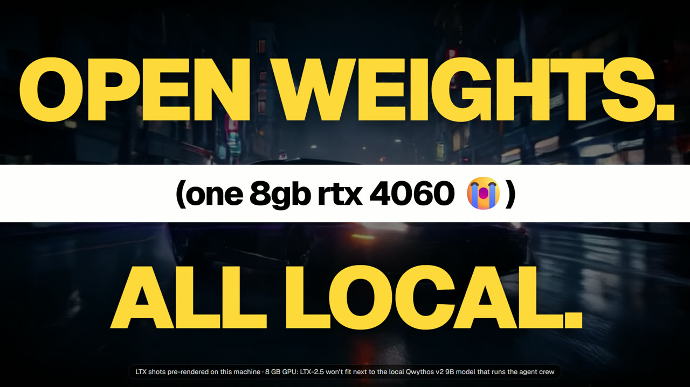
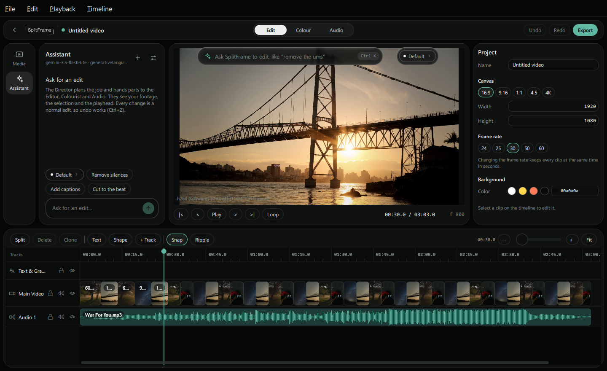
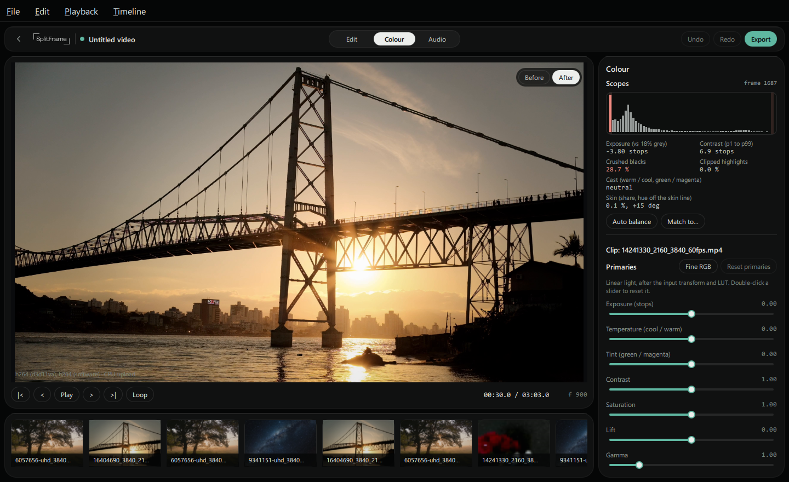
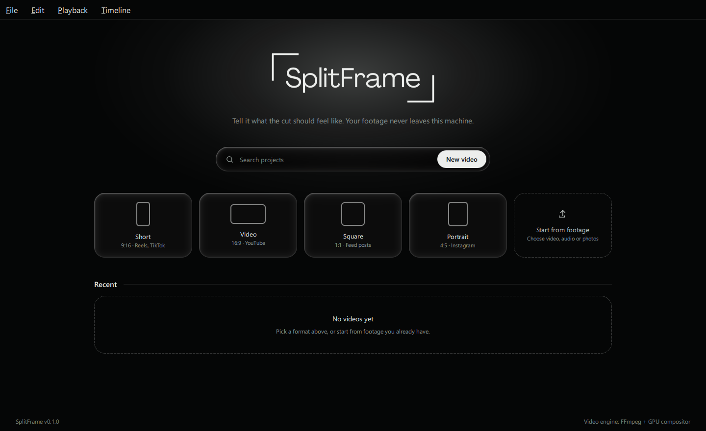

# SplitFrame

**An AI-enabled video editor. Local-first, open weights, open source.**

SplitFrame is a full non-linear video editor that works without any AI. On top of it sits a crew of
AI agents (a Director plus specialists) that can drive everything a human can: cut, trim, grade,
mix audio, sync to the beat, export. ComfyUI is built in, so the same crew can generate video,
image and music shots straight onto the timeline.

[Watch the launch video](https://drive.google.com/file/d/1rGyXaAp6waD-r2VynNKSSlEyFFohBwPh/view?usp=sharing) (100 s. Shots by LTX-2.5 and music by ACE-Step 1.5, both generated locally on the 8 GB laptop)

License: [GPL-3.0-or-later](LICENSE) · Native app: C++20, Qt 6.8, FFmpeg · Windows is the only tested platform

---

## Screenshots

The editor with the Assistant open. The Director plans the job and hands parts to the Editor, Colourist and Audio agents:

| Colour page: scopes, auto balance, primaries in linear light | Home |
|---|---|
|  |  |

## What it is

- **A real editor first.** Multi-track timeline, preview, trim/split/move, undo/redo, colour
  management, audio mixing, export (NVENC when available, otherwise software). Everything works
  with no AI model connected.
- **An agent crew.** A Director routes your request to specialists (editor, colourist, audio).
  Modes: Plan (show the plan first), Ask before edits, Default, Auto. Agents call the same typed
  editing commands as the UI, so every agent edit is a normal undoable edit.
- **ComfyUI built in.** Generated shots land on the timeline in one undo step. The intended open
  models are LTX-2.5 (video), Z-Image (image) and ACE-Step 1.5 (music). You can render variants of
  a shot as a contact sheet and pick one by letter.
- **Local-first.** The crew talks to any OpenAI-compatible server. The default is a local
  `llama-server` on `127.0.0.1:8080` running Qwythos v2 9B. A cloud endpoint is optional.
- **One command surface for everything.** The GUI, the `splitframe-cli` tool, a local JSON-RPC API
  and an MCP server all call the same engine commands, so other agents can drive SplitFrame too.

## Hardware note (honest version)

SplitFrame was built and tested on one laptop with an 8 GB RTX 4060. LTX-2.5 does not fit in 8 GB
next to the local Qwythos v2 9B model that runs the agent crew. The LTX shots in the launch video
were therefore rendered ahead of time, not live in the same session as the agent. A machine with
more VRAM, or a cloud/second-machine model server for the agents, avoids this.

## Quick start (Windows)

You need Visual Studio 2022 Build Tools (C++ workload), CMake 3.25+, Qt 6.8 (`msvc2022_64`) and a
shared GPL FFmpeg 8.1 build. Details and exact modules are in [`native/README.md`](native/README.md).

1. Clone the repo and check out the `comfy` branch. [UPDATE: I fast-forwarded main to the comfy branch, so main now reflects everything that the comfy branch has.]
2. Double-click [`run_build.bat`](run_build.bat) in the repo root. It configures the `debug` preset
   if needed, builds, and opens `native\build\debug\bin\splitframe.exe`.
   It assumes Qt in `C:\Qt\6.8.3\msvc2022_64`, FFmpeg in `C:\dev\ffmpeg-8.1-gpl` and optional
   OpenColorIO in `C:\dev\ocio`. Set `QT_ROOT`, `FFMPEG_ROOT` or `OCIO_ROOT` to use other folders.
3. Connect a model server for the agents and, if you want generation, a ComfyUI. See
   [`native/README.md`](native/README.md) (sections "AI / LLM settings" and "Generate with ComfyUI").

SplitFrame never downloads model weights. You bring the LLM and the ComfyUI models yourself.

## Layout

The app lives in [`native/`](native/README.md):

| Path | What |
|---|---|
| `native/src/core` | Project model: time, schema, JSON load/save, ops, undo history. No GUI. |
| `native/src/media` | FFmpeg probe, decode, frame cache, audio decode. |
| `native/src/render` | Compositor on QRhi (D3D11), shared by preview and export. |
| `native/src/audio` | Mixer, effects, meters, output. |
| `native/src/export` | Render and encode to file. |
| `native/src/editor` | Editing logic: project, media pool, timeline controller, inspector. |
| `native/src/engine` | Headless engine: one typed command set, JSON-RPC API, MCP server, `splitframe-cli`. |
| `native/src/agent` | Director, specialists, peer bus, harness over any OpenAI-compatible LLM server. |
| `native/src/comfy` | ComfyUI client, process manager, workflow graph, validator, generation jobs. |
| `native/src/app` | Qt Quick UI. |
| `native/tests` | QtTest suites, run with `ctest`. |

`apps/desktop` is the older Electron implementation (the project was once called Cutboard). It is
kept only as a reference.

## License

GPL-3.0-or-later. See [LICENSE](LICENSE). Code inherited from openCardboard is also available
under MIT; see [NOTICE.md](NOTICE.md). Third-party components and codec notes are listed in
[THIRD_PARTY_LICENSES.md](THIRD_PARTY_LICENSES.md). Generated media follows the licenses of the
model weights you run.
